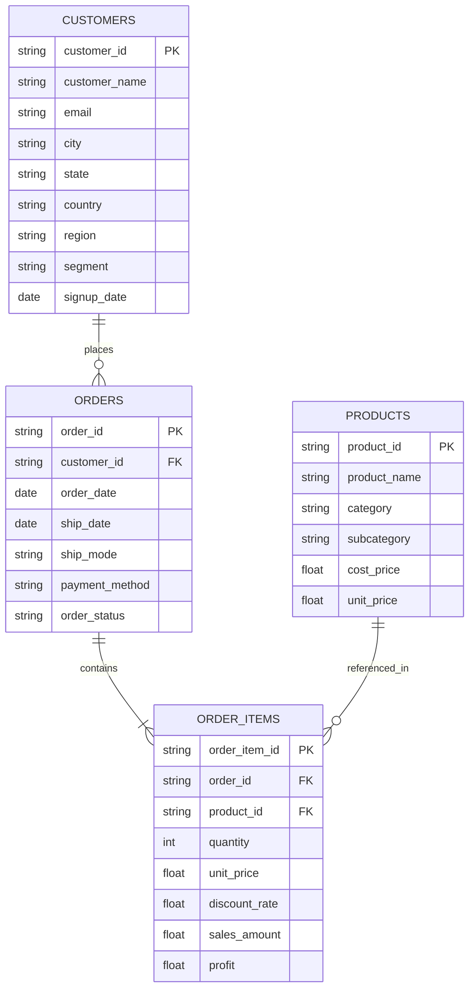

# SQL for Data Analysts: Complete Query Practice & Theory Guide

Welcome to the **SQL Data Analyst Master Practice Guide**. This guide accompanies the SQLite database [`retail_sales.db`](file:///c:/Users/SANTHOSH/Desktop/blue_stocks/02_sql_practice/retail_sales.db), the production query suite [`sql_practice_queries.sql`](file:///c:/Users/SANTHOSH/Desktop/blue_stocks/02_sql_practice/sql_practice_queries.sql), and the automated runner [`run_sql_exercises.py`](file:///c:/Users/SANTHOSH/Desktop/blue_stocks/02_sql_practice/run_sql_exercises.py).

---

## Table of Contents
1. [The Database Schema & Relational Design](#1-the-database-schema--relational-design)
2. [The True SQL Order of Execution](#2-the-true-sql-order-of-execution)
3. [Level 1: Filtering & Sorting (SELECT, WHERE, ORDER BY)](#3-level-1-filtering--sorting)
4. [Level 2: Aggregation & Grouping (GROUP BY vs HAVING)](#4-level-2-aggregation--grouping)
5. [Level 3: Relational Joins Deep-Dive](#5-level-3-relational-joins-deep-dive)
6. [Level 4: Subqueries and Common Table Expressions (CTEs)](#6-level-4-subqueries-and-ctes)
7. [Level 5: Window Functions Masterclass](#7-level-5-window-functions-masterclass)
8. [Level 6: Strategic Business Intelligence Analysis](#8-level-6-strategic-business-intelligence-analysis)
9. [Interview Performance & Optimization Rules](#9-interview-performance--optimization-rules)

---

## 1. The Database Schema & Relational Design

The `retail_sales.db` database is normalized into four relational tables:



---

## 2. The True SQL Order of Execution

One of the most frequent misconceptions in SQL is assuming queries execute in the order they are written (`SELECT ... FROM ... WHERE ...`). 

The SQL database engine parses and processes clauses in this exact order:

```
1. FROM        (Identify base tables)
2. ON / JOIN   (Filter join conditions and join tables)
3. WHERE       (Row-level pre-filter)
4. GROUP BY    (Aggregate rows into distinct groups)
5. HAVING      (Filter aggregated groups)
6. SELECT      (Evaluate expressions and project columns)
7. DISTINCT    (Eliminate duplicate output rows)
8. WINDOW      (Evaluate window functions OVER (...))
9. ORDER BY    (Sort final result set)
10. LIMIT / TOP(Restrict output count)
```

> [!IMPORTANT]
> Because `WHERE` runs at Step 3 and `GROUP BY` runs at Step 4, you **cannot** filter aggregate calculations (like `SUM(sales) > 1000`) inside a `WHERE` clause! You must use `HAVING` (Step 5).

---

## 3. Level 1: Filtering & Sorting

### Key Syntax Concepts
- **`WHERE`**: Filters rows before any grouping occurs.
- **`IN ('Val1', 'Val2')`**: Compact alternative to multiple `OR` statements.
- **`BETWEEN low AND high`**: Inclusive numerical and date boundary filtering.
- **`LIKE '%Pattern%'`**: Wildcard string matching (`%` matches any sequence; `_` matches single character).
- **`CASE WHEN ... THEN ... ELSE ... END`**: In-query conditional logic.

```sql
SELECT product_name, unit_price,
    CASE 
        WHEN unit_price >= 1000 THEN 'Premium / Luxury'
        WHEN unit_price BETWEEN 300 AND 999.99 THEN 'Mid-Tier'
        ELSE 'Budget / Standard'
    END AS Price_Tier
FROM products;
```

---

## 4. Level 2: Aggregation & Grouping

### The Cardinal Rule of `GROUP BY`
Any non-aggregated column in the `SELECT` list **MUST** appear in the `GROUP BY` clause.

### `WHERE` vs `HAVING` Cheat Sheet
| Attribute | `WHERE` | `HAVING` |
| :--- | :--- | :--- |
| **Operates On** | Individual raw rows | Aggregated groups |
| **Execution Point** | Before `GROUP BY` | After `GROUP BY` |
| **Can use `SUM()`, `AVG()`?** | **NO** (Throws syntax error) | **YES** |
| **Example** | `WHERE order_status = 'Completed'` | `HAVING SUM(sales_amount) > 25000` |

---

## 5. Level 3: Relational Joins Deep-Dive

### Types of Joins
1. **`INNER JOIN`**: Returns only records where the join key matches in **both** tables.
2. **`LEFT JOIN`**: Returns all rows from the left table, plus matched rows from the right table (unmatched right rows become `NULL`).
3. **Finding Inactive / Orphan Records with `LEFT JOIN`**:
```sql
SELECT c.customer_name, c.email
FROM customers c
LEFT JOIN orders o ON c.customer_id = o.customer_id
WHERE o.order_id IS NULL;
```
If an order was never placed, `o.order_id` is `NULL`.

---

## 6. Level 4: Subqueries and CTEs

### Scalar Subqueries
Returns a single value (1 row, 1 column), which can be dropped into comparisons:
```sql
SELECT product_name, unit_price
FROM products
WHERE unit_price > (SELECT AVG(unit_price) FROM products);
```

### Common Table Expressions (CTEs) - The `WITH` Clause
CTEs replace messy nested subqueries with clean, sequential, readable temporary tables.
```sql
WITH Monthly_Sales AS (
    SELECT SUBSTR(order_date, 1, 7) AS Order_Month, SUM(sales_amount) AS Revenue
    FROM orders o JOIN order_items oi ON o.order_id = oi.order_id
    GROUP BY SUBSTR(order_date, 1, 7)
)
SELECT Order_Month, Revenue
FROM Monthly_Sales
WHERE Revenue > 50000;
```

---

## 7. Level 5: Window Functions Masterclass

Window functions perform calculations across a set of table rows that are related to the current row, **without collapsing them into a single summary row**.

### The Anatomy of an `OVER()` Clause
$$\text{FUNCTION}()\ \text{OVER}\ (\text{PARTITION BY } \text{col}_1\ \text{ORDER BY } \text{col}_2\ \text{ROWS BETWEEN ...})$$

1. **`PARTITION BY`**: Divides the dataset into independent calculation pools (like a local `GROUP BY`).
2. **`ORDER BY`**: Dictates the sequence of calculation within each partition.
3. **Window Frame**: Specifies how many rows preceding or following to include in a rolling calculation.

### Ranking Functions Compared
| Function | Behaviour on Ties | Example Output for Scores: `[100, 100, 90]` |
| :--- | :--- | :--- |
| **`ROW_NUMBER()`** | Sequential arbitrary integers | `1, 2, 3` |
| **`RANK()`** | Skips ranks after ties | `1, 1, 3` (rank 2 is skipped) |
| **`DENSE_RANK()`** | Never skips ranks | `1, 1, 2` |

### Lead and Lag for Trend Analysis
- **`LAG(column, offset)`**: Looks backward $N$ rows (ideal for Month-over-Month calculation).
- **`LEAD(column, offset)`**: Looks forward $N$ rows.

```sql
SELECT Order_Month, Current_Month_Revenue,
    LAG(Current_Month_Revenue, 1) OVER (ORDER BY Order_Month) AS Prev_Month_Revenue,
    ROUND((Current_Month_Revenue - LAG(Current_Month_Revenue, 1) OVER (ORDER BY Order_Month)) /
          LAG(Current_Month_Revenue, 1) OVER (ORDER BY Order_Month) * 100, 2) AS MoM_Growth_Pct
FROM Monthly_Sales;
```

---

## 8. Level 6: Strategic Business Intelligence Analysis

### 8.1 Customer Lifetime Value (CLV) & RFM Segmentation
Using `NTILE(4)` to calculate:
- **Recency ($R$):** Days since customer's last purchase.
- **Frequency ($F$):** Total purchase count.
- **Monetary ($M$):** Total dollars spent.
Customers with high $R, F, M$ are designated **Champions**, while customers with low $R$ but high historical $M$ receive **At Risk / Winback** alerts.

### 8.2 Margin Erosion & Promotional Discount Audit
Our practice query revealed:
- **0% Discount Orders:** Realized margin = **34.65%**
- **1% - 10% Discount Orders:** Realized margin = **29.54%**
- **11% - 20% Discount Orders:** Realized margin = **20.90%**
- **>20% Clearance Orders:** Realized margin = **9.49%** (Severe margin erosion)

---

## 9. Interview Performance & Optimization Rules

1. **Sargable Queries (Search Argument Able):**
   - **Bad:** `WHERE YEAR(order_date) = 2024` (Prevents index lookup, forces full table scan).
   - **Good:** `WHERE order_date >= '2024-01-01' AND order_date < '2025-01-01'`.
2. **Avoid `SELECT *` in Production:**
   - Always name specific columns to minimize I/O overhead and network payload.
3. **Join on Indexed Foreign Keys:**
   - Always ensure join columns (`customer_id`, `product_id`, `order_id`) have B-Tree indices.
4. **Beware of `NULL` in Boolean Logic:**
   - In SQL, `NULL = NULL` evaluates to `UNKNOWN`, not `TRUE`. Always use `IS NULL` or `COALESCE()`.

